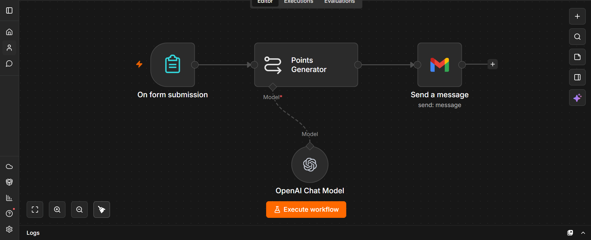
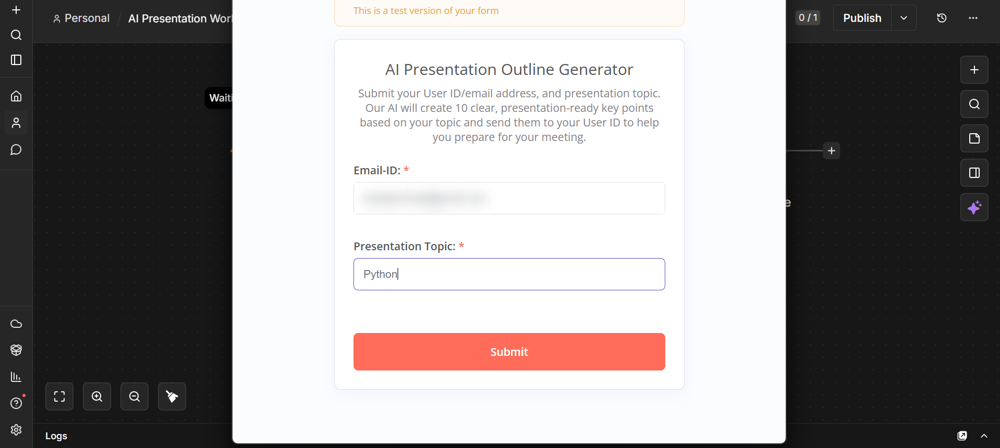
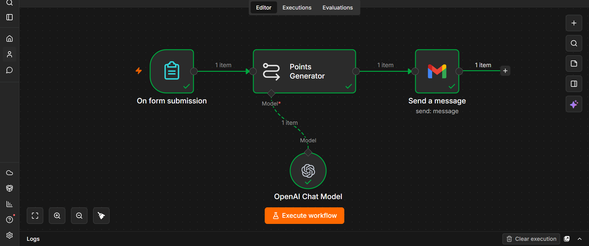
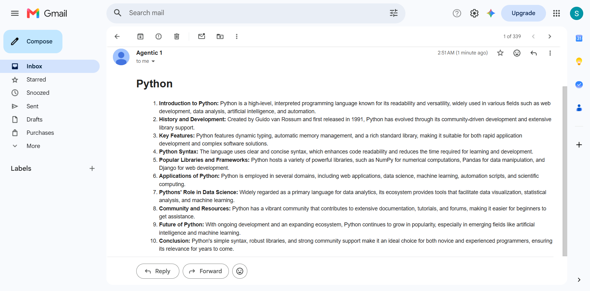

# 🎤 AI Presentation Outline Generator

An **n8n** workflow that turns a presentation topic into a structured, AI-generated outline and emails it to you as a nicely formatted HTML message.



---

## ✨ Features

- 📝 Simple n8n Form to collect a topic and an email address
- 🤖 AI-generated presentation points using OpenAI (`gpt-4o-mini`)
- 🎨 HTML-formatted output for a clean, readable email
- 📧 Automatic delivery via Gmail
- ⚡ Fully automated — no manual steps after submission

---

## 🔄 How It Works

```text
Form Submission ──► Points Generator (LLM Chain + OpenAI) ──► Gmail: Send Message
```

1. **On form submission** – the user enters their email and a presentation topic.
2. **Points Generator** – an LLM chain powered by OpenAI creates a structured presentation outline.
3. **Send a message** – Gmail sends the outline to the user's email in HTML format.

---

## 🛠️ Tech Stack

| Tool | Purpose |
| --- | --- |
| n8n | Workflow automation |
| n8n Forms | User input |
| OpenAI (`gpt-4o-mini`) | Outline generation |
| Gmail | Email delivery |

---

## 📥 Setup

1. Download [`workflow.json`](workflow.json).
2. In n8n, go to **Workflows → Import from File** and select it.
3. Add your credentials:
   - **OpenAI API** for the *OpenAI Chat Model* node
   - **Gmail OAuth2** for the *Send a message* node
4. Activate the workflow and open the form URL.

### Form fields

| Field | Type |
| --- | --- |
| Email-ID | Email |
| Presentation Topic | Text |

---

## 📸 Screenshots

| Submission form | Execution |
| --- | --- |
|  |  |

**Final result (email):**



---

## 💡 Use Cases

- Preparing class or conference talks
- Quickly drafting slide structures for meetings
- Brainstorming talking points on a new topic

---

## 📜 License

This project is licensed under the [MIT License](LICENSE).
